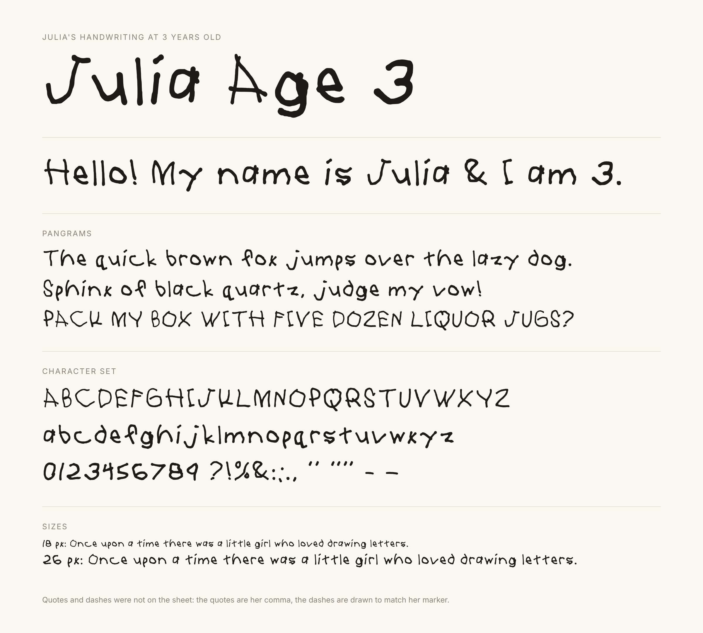

# Julia Age 3

A font made from Julia's handwriting sheet, filled in at 3 years old.



## Files

| File | Use |
|---|---|
| `fonts/JuliaAge3-Regular.otf` | Install on a Mac or PC (double-click it) |
| `fonts/JuliaAge3-Regular.ttf` | Same font with TrueType outlines, for apps that only take TTF |
| `fonts/JuliaAge3-Regular.woff2` | For web pages (`@font-face`) |
| `specimen.html` | The sample sheet above. Open it in a browser. |
| `source/julia-handwriting-sheet.jpg` | The photo the font was made from |
| `build_font.py` | Rebuilds all three fonts from the photo |

## What's in it

- **From her sheet:** `A–Z`, `a–z`, `0–9` and `? ! % & : ; . ,`
- **Added to fill gaps:** space, `' ’ ‘ " ” “` (her comma, raised or turned round), and `-` and `–`
  (drawn to match her marker stroke, since the sheet had no hyphen).
- **Not in it:** the rows she left blank on the sheet (`+ - ~ = ± # $ € £ ¢ [ ] ( ) { } < > \ / * @` and so on).
  Apps will show these in a fallback font.

## How it was made

1. The lighting in the photo is evened out, and the printed grid lines are found and fitted with curves,
   because the paper was not lying flat.
2. Each cell is straightened with its own perspective correction, and her marker strokes are cut out at 4×
   the photo's resolution. The printed labels and grid lines are thinner than the marker, so they are left out.
3. Each letter is traced into smooth outlines with potrace.
4. **Sizes and heights are evened out 80% of the way, not all the way,** so the letters line up but still
   look hand-drawn. Each letter moves most of the way toward the typical height of its kind (capitals,
   small letters like `a e o`, tall letters like `b d h`, digits), measured on her own letters. Strokes
   keep the thickness she drew when a letter is resized. Her capitals are set to 0.7 em tall.
5. Letters sit on a common baseline, keeping a fifth of the bounce she drew. `g j p q y` hang below the
   line (at three she mostly wrote them sitting on it), and her `Q` keeps its tail below the line.
6. Spacing is even on both sides of each letter. Automatic kerning (about 1,800 pairs) closes the gaps that
   open shapes leave, such as after her `J`, `T` and `L`.

## Rebuild

```
pip install -r requirements.txt     # plus the potrace program (apt install potrace / brew install potrace)
python3 build_font.py               # writes fonts/ and build/ (extracted letters, kerning)
```

To change how much the letters are evened out, set `ALIGN` in `build_font.py` (0 = exactly as drawn,
1 = fully even) and rebuild. The other sizing and spacing settings are next to it.
